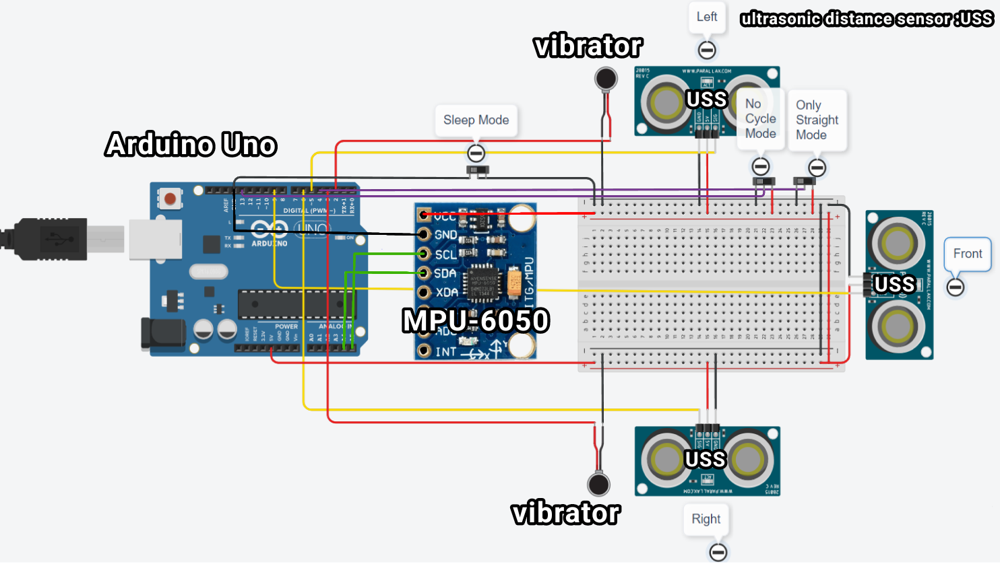
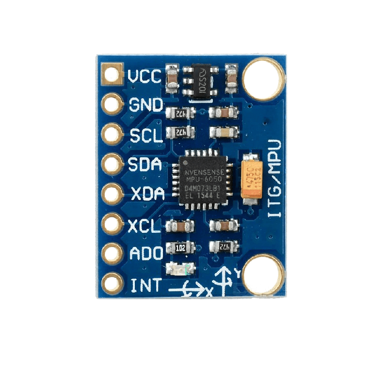

# Motion Glasses

Dual-mode assistive navigation glasses using ultrasonic distance sensing, head orientation tracking, and directional haptic vibration feedback.


---

## Overview

Motion Glasses is a wearable assistive navigation system designed to help visually impaired individuals navigate indoor and outdoor spaces. Standard mobility aids such as white canes detect obstacles only at ground level and directly along the cane's sweep path. Motion Glasses expands spatial awareness by monitoring three directional sectors at head level while tracking head pitch angle to switch dynamically between distance navigation and ground topography tracking.

The system addresses sensory fatigue through an integrated cycle counter that automatically mutes vibration when a user remains stationary near an obstacle, reactivating immediately when motion or distance changes.

### Key Capabilities

- **Tri-directional obstacle sensing**: Three ultrasonic sensors cover front, left, and right zones with a 100 cm warning perimeter.
- **Head orientation-driven mode switching**: An onboard MPU-6050 inertial measurement unit tracks head tilt (pitch angle):
  - **Straight Mode** (pitch > 30°): Detects forward and side obstacles.
  - **Down Mode** (pitch ≤ 30°): Monitors the ground surface ahead to detect curbs, steps, and drop-offs.
- **Dynamic ground calibration**: Samples and averages 10 readings on startup to establish the user's standing height baseline ground level.
- **Anti-fatigue cycle limiter**: Suppresses continuous vibration after 46 consecutive identical reading cycles (~4.6 seconds at 100 ms loop intervals).
- **Manual override switches**: Hardware slide switches to force Straight Mode or disable cycle timeout suppression.
- **Software simulation harness**: Pure Python simulation package and CLI test runner with automated test coverage.

---

## Hardware Architecture

### Components

- **Microcontroller**: Arduino Uno (ATmega328P)
- **IMU**: MPU-6050 6-axis accelerometer & gyroscope (I2C interface: SDA A4, SCL A5)
- **Distance Sensors**: 3x Ultrasonic sensors (HC-SR04 configured in single-pin I/O mode or Parallax Ping):
  - Front sensor: Digital Pin 9
  - Right sensor: Digital Pin 6
  - Left sensor: Digital Pin 5
- **Haptic Actuators**: 2x Vibration motors driven via switching transistors:
  - Left motor: Digital Pin 2
  - Right motor: Digital Pin 3
- **Slide Switches**:
  - Straight Mode override: Digital Pin 4
  - Cycle Limit disable: Digital Pin 13

### Circuit Schematic



### Sensor Pinout



---

## Operational Logic

### Navigation Truth Table

| Mode | Condition | Sensor Reading | Left Motor | Right Motor | Indication |
|---|---|---|---|---|---|
| **Straight** | Pitch > 30° or Pin 4 HIGH | Front ≤ 100 cm | ON | ON | Obstacle directly ahead |
| **Straight** | Pitch > 30° or Pin 4 HIGH | Right ≤ 100 cm | OFF | ON | Obstacle to the right |
| **Straight** | Pitch > 30° or Pin 4 HIGH | Left ≤ 100 cm | ON | OFF | Obstacle to the left |
| **Straight** | Pitch > 30° or Pin 4 HIGH | All > 100 cm | OFF | OFF | Path clear |
| **Down** | Pitch ≤ 30° and Pin 4 LOW | Front ≤ Ground Level | OFF | ON | Raised obstacle / curb ahead |
| **Down** | Pitch ≤ 30° and Pin 4 LOW | Front > Ground Level | ON | OFF | Drop-off / hole / descending stairs |
| **Sleep / Fault** | Any sensor | Any distance = 0 cm | OFF | OFF | Sensor fault / timeout |
| **Anti-Fatigue** | Stationary | Cycles ≥ 46 | OFF | OFF | Auto-mute (reactivates on movement) |

---

## Verification Results

The firmware logic was validated across 7 functional scenarios using the simulation test bench:

| Scenario | Pitch (deg) | Distances (F, R, L) cm | Output Mode | Vibration State | Verification Result |
|---|---|---|---|---|---|
| **Clear Path** | 40.0° | 200.0, 180.0, 190.0 | `STRAIGHT` | `OFF` | Passed (Silent) |
| **Front Obstacle** | 40.0° | 80.0, 150.0, 150.0 | `STRAIGHT` | `BOTH (FRONT OBSTACLE)` | Passed (Both active) |
| **Stationary Auto-Mute** | 40.0° | 80.0, 150.0, 150.0 (Cycle 50) | `STRAIGHT` | `OFF` | Passed (Muted after 46 cycles) |
| **Right Obstacle** | 40.0° | 180.0, 45.0, 150.0 | `STRAIGHT` | `RIGHT MOTOR ON` | Passed (Right active) |
| **Left Obstacle** | 40.0° | 180.0, 150.0, 45.0 | `STRAIGHT` | `LEFT MOTOR ON` | Passed (Left active) |
| **Down: Curb / Step Up** | 15.0° | 70.0, 100.0, 100.0 | `DOWN` | `RIGHT MOTOR ON` | Passed (Right active) |
| **Down: Drop-off / Hole** | 15.0° | 160.0, 100.0, 100.0 | `DOWN` | `LEFT MOTOR ON` | Passed (Left active) |

All 13 automated unit tests pass under `pytest`.

---

## Repository Structure

```text
motion-glasses/
├── assets/
│   ├── circuit_diagram.png      # Hardware wiring and Tinkercad schematic
│   └── mpu6050_pinout.png       # MPU-6050 pin mapping reference
├── firmware/
│   └── motion_glasses.ino       # Production Arduino C++ firmware
├── src/
│   └── motion_glasses/
│       ├── __init__.py          # Package exports
│       ├── cli.py               # CLI entry point and scenario runner
│       ├── controller.py        # Core state machine and decision logic
│       └── simulator.py         # Test scenarios and telemetry generator
├── tests/
│   └── test_controller.py       # Unit test suite
├── .gitignore                   # Standard repository ignores
├── .python-version              # Pinned Python version (3.13)
├── LICENSE                      # MIT License
├── pyproject.toml               # Project metadata and dependencies
└── uv.lock                      # Resolved dependency lockfile
```

---

## Installation & Simulation

The Python simulation suite requires Python 3.10+ and uses [`uv`](https://github.com/astral-sh/uv) for package and environment management.

### 1. Install uv

If `uv` is not already installed:

```bash
curl -LsSf https://astral.sh/uv/install.sh | sh
```

### 2. Sync Environment

Clone the repository and sync dependencies:

```bash
git clone <repository-url>
cd motion-glasses
uv sync
```

### 3. Run Simulation Scenarios

Execute the predefined functional test scenarios:

```bash
uv run motion-glasses-sim
```

### 4. Interactive Simulation Mode

Run the interactive prompt to test custom distance and pitch inputs:

```bash
uv run motion-glasses-sim --interactive
```

Example interactive input:

```text
Enter [df dr dl pitch] (e.g. 50 150 150 45): 40 120 120 45
Mode: STRAIGHT | Pitch: 45.0 deg | Vibration: BOTH (FRONT OBSTACLE) | Cycles: F=0 R=0 L=0
```

### 5. Run Test Suite

Run unit tests and linters:

```bash
uv run pytest
uv run ruff check .
```

---

## Firmware Deployment (Arduino)

To flash the firmware to an Arduino Uno:

1. Install the [Arduino IDE](https://www.arduino.cc/en/software) or `arduino-cli`.
2. Install the **MPU6050** library by Electronic Cats via the Arduino Library Manager.
3. Connect the Arduino Uno to your workstation via USB.
4. Wire the sensors and actuators according to the [Circuit Schematic](assets/circuit_diagram.png).
5. Open `firmware/motion_glasses.ino` in the Arduino IDE.
6. Select Board: **Arduino Uno** and your serial port.
7. Click **Upload** (or run `arduino-cli compile --upload -b arduino:avr:uno -p /dev/ttyACM0 firmware`).
8. Open the Serial Monitor at **9600 baud** to view real-time orientation and distance telemetry.

---

## Limitations & Considerations

- **Ultrasonic reflection**: Acoustic sensors have a beam cone (~15°). Highly angled surfaces or sound-absorbing fabrics (e.g. thick wool coats) can reduce effective echo return.
- **Hysteresis**: The cycle counter performs exact discrete distance comparison (`preDF == df`). On real sensors with minor noise, stationary distances may oscillate by ±1 cm. For production hardware deployments, a ±2 cm deadband hysteresis is recommended.
- **Sensor latency**: Sequential distance readings take up to 30 ms per sensor. Total loop period is ~100 ms, corresponding to a 10 Hz refresh rate.

---

## License

This project is licensed under the [MIT License](LICENSE).

## Author

**Ahmad Serieh**  
Email: [ahmadserieh.official@gmail.com](mailto:ahmadserieh.official@gmail.com)
